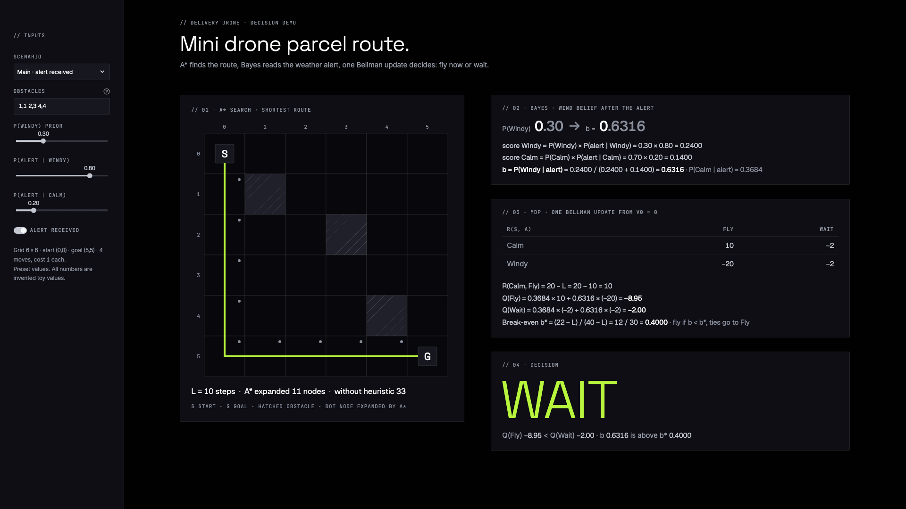

# Mini Drone Parcel Route

A delivery drone on a 6×6 town grid must carry one parcel from the depot to a customer. Before take-off it gets a weather alert and has to decide: **fly now or wait**. Three AI algorithms solve it together: A\* search and Bayesian inference each supply an independent input (the route length L and the wind belief b), and the MDP combines the two into one decision.



## The pipeline

| Step | Algorithm | Question | Output passed to the MDP |
|---|---|---|---|
| 1 | **A\* search** · Manhattan heuristic, 4 directions, step cost 1 | What is the shortest route around the obstacles? | route length **L** |
| 2 | **Bayesian inference** | After the alert, how likely is strong wind? | belief **b = P(Windy \| alert)** |
| 3 | **MDP, one Bellman update** from V₀ = 0 | Fly now or wait? | the action |

- **A\*** expands the open node with the smallest f = g + h. Ties in f go to the smaller h, then to the node pushed first (an insertion counter). Manhattan distance never overestimates on this grid, so the route is optimal.
- **Bayes:** b = P(alert | W)·P(W) / [P(alert | W)·P(W) + P(alert | C)·P(C)]. With no alert, the "no alert" likelihoods 1 − P(alert | ·) are used.
- **MDP:** R(Calm, Fly) = 20 − L, R(Windy, Fly) = −20, R(·, Wait) = −2. Because V₀ = 0, Q(s, a) = R(s, a), and the drone weights the two states by b:
  Q(Fly) = (1 − b)(20 − L) + b(−20), Q(Wait) = −2. The larger Q wins.
- **Decision rule:** the larger computed Q wins. An exact computed tie goes to Fly, because `max` returns the first action in the list, as in the notebook.
- **Break-even belief:** analytically Q(Fly) = Q(Wait) at b\* = (22 − L) / (40 − L), which is 0.40 for L = 10. This is the analytic threshold, not a guarantee of a computed tie: floating-point rounding can tip values exactly at it either way. Prior 0.40 with both sensor rates 0.50 gives an exact computed tie (Fly); L = 12 with b = 10/28 gives Q(Fly) a hair below −2, so Wait. The app reports which computed score is higher when both round to the same two decimals.

## Results

Main scenario: start (0,0), goal (5,5), obstacles (1,1) (2,3) (4,4); P(Windy) = 0.30, P(alert | Windy) = 0.80, P(alert | Calm) = 0.20.

| Case | L | A\* nodes (h = 0) | b | Q(Fly) | Q(Wait) | Decision |
|---|---|---|---|---|---|---|
| Alert received | 10 | 11 (33) | 0.6316 | −8.95 | −2.00 | **Wait** |
| No alert | 10 | 11 (33) | 0.0968 | 7.10 | −2.00 | **Fly** |
| Two long walls, no alert | 20 | 21 (26) | 0.0968 | −1.94 | −2.00 | **Fly** (only just) |
| Goal walled in | no route | 33 (33) | not used | not computed (no route) | not computed (no route); the app shows the fixed Wait reward −2 | **Wait** |

The alert raises the wind belief from 0.30 to 0.6316, above b\* = 0.40, so the drone waits. Without the alert the belief drops to 0.0968 and it flies.

## Repository layout

```
drone/        astar.py · bayes.py · mdp.py · pipeline.py   (moved from the notebook, logic unchanged)
              inputs.py                                     (strict obstacle validation for the app)
tests/        pytest: the notebook's test cases plus property checks
app.py        the local Streamlit demo
notebook/     aif-project-notebook.ipynb                     (the original notebook, unchanged)  
docs/         technical report (aif-project-report.pdf), slides (aif-project-slides.pdf),
              2:51 demo video (aif-project-demo-video.mp4 + .srt), app screenshot,
              AI usage declaration (ai-declaration.md + .pdf), team contribution statement
fonts/        vendored OFL fonts, inlined into the page as data URIs
```

## How to run

Python 3.12.

```bash
python3.12 -m venv .venv
source .venv/bin/activate            # Windows: .venv\Scripts\activate
pip install --require-hashes -r requirements.txt
streamlit run app.py                 # opens on http://localhost:8501
```

Tests:

```bash
pip install --require-hashes -r requirements-dev.txt
pytest
```

The app's sidebar has a **Scenario** picker (Main · alert received, No alert, Two long walls, Goal walled in) that fills in the controls, an **Obstacles** field (`row,col` cells separated by spaces, for example `1,1 2,3 4,4`), three probability sliders and an **Alert received** toggle. The main area shows, in order: the grid with the A\* route, the Bayes update with its arithmetic, the MDP reward table and Q values with b\*, and the decision.

## Tests

`pytest` runs the notebook's own cases (the four scenarios above and the 11 vs 33 node counts) and property checks: A\* and the h = 0 search return equal route lengths on 200 seeded random grids, Manhattan distance never exceeds the true BFS distance, posteriors sum to 1, the decision flips exactly at b\* = (22 − L) / (40 − L) (with an exact-tie regression test: Fly wins), Bayes rejects zero evidence, and a walled-in goal always gives Wait. The BFS used as ground truth has its own neighbour generator. CI runs them on every push.

## Assumptions and limits

- **All numbers are invented** toy values: the map, the sensor probabilities and the rewards.
- One sensor reading, one decision step (a single Bellman update from V₀ = 0), so waiting has no future value beyond its fixed cost.
- The wind is assumed to be the same over the whole map; every step costs the same battery.

## Possible improvements

1. Full value iteration with weather transitions (Calm ↔ Windy over time), so waiting has a real future value.
2. A hidden Markov model to track the wind over several alerts instead of one.
3. A wind-risk cost per cell inside A\* (cost = steps + risk), so the route itself avoids windy areas.

## Security

The app is local-only: it binds to `localhost`, makes no network requests, serves no static files, has no uploads, and installs pinned, hash-checked dependencies. See [SECURITY.md](SECURITY.md).

## AI use

AI tools were used in this project. What was used and how is declared in [docs/ai-declaration.md](docs/ai-declaration.md).

## Licence

Code: [MIT](LICENSE). Fonts in `fonts/`: SIL Open Font License 1.1 (see [fonts/OFL.txt](fonts/OFL.txt)).
